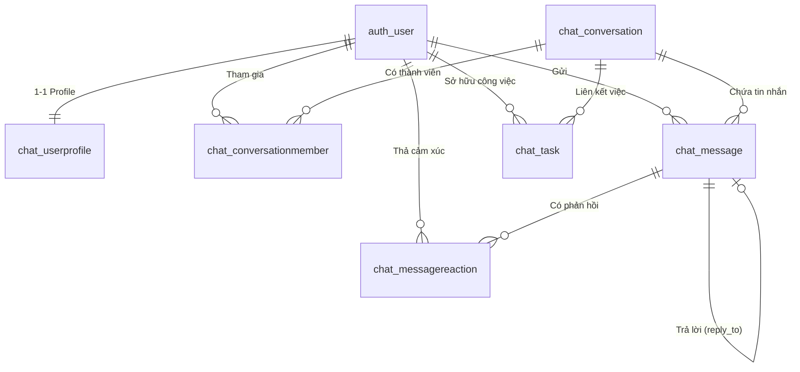
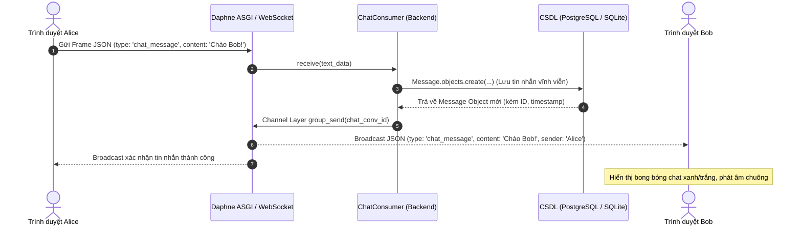
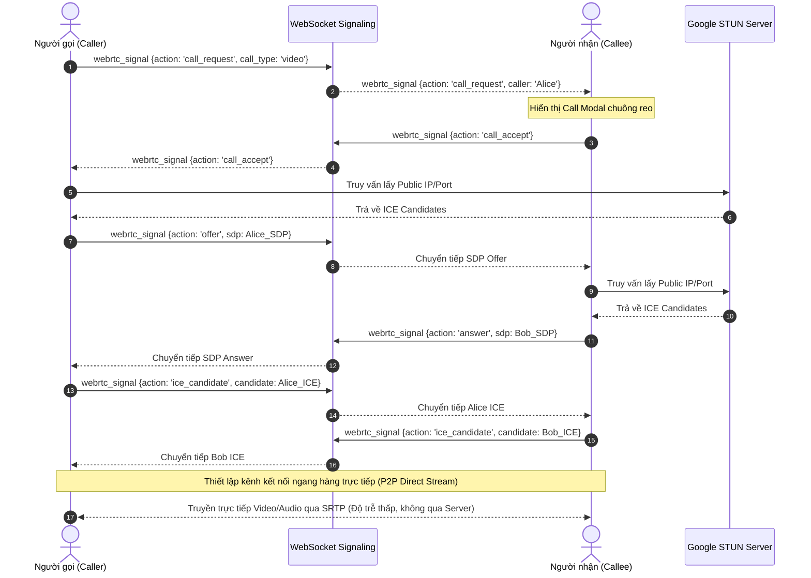

# HƯỚNG DẪN CẬP NHẬT VÀ CHỈNH SỬA BÁO CÁO ĐỒ ÁN LẬP TRÌNH MẠNG
> **Dành cho:** Phạm Huỳnh Quân (24IT220) & Lê Phú Bảo (24IT018)  
> **Đề tài:** SỬ DỤNG MÔ HÌNH CLIENT – SERVER VÀ GIAO THỨC TCP/IP ĐỂ XÂY DỰNG ỨNG DỤNG CHAT ROOM (MÔ PHỎNG ZALO WEB & TCP SOCKET)  
> **Giảng viên hướng dẫn:** ThS. Nguyễn Thanh Cẩm  
> **File Word gốc:** `KHMT_BC_LapTrinhMang_PhamHuynhQuan_244IT220_LePhuBao_24IT018.docx`

---

## I. TỔNG QUAN TÌNH TRẠNG FILE BÁO CÁO HIỆN TẠI

Qua việc phân tích chi tiết file Word mẫu, hiện tại báo cáo đang là **file mượn từ đồ án "Hệ thống lưu trữ và chia sẻ file"** của một nhóm khác làm bằng **Kotlin / Java RMI / MySQL / IntelliJ IDEA**.

| Thành phần | Thực trạng trong file Word mẫu | Thực tế dự án hiện tại của bạn | Đánh giá & Hướng xử lý |
| :--- | :--- | :--- | :--- |
| **Trang bìa & Tên đề tài** | Đề tài Chat Room, nhưng MSSV Quân bị gõ nhầm: `244IT220` (dư số 4). | Phạm Huỳnh Quân (`24IT220`), Lê Phú Bảo (`24IT018`), Lớp `24SE3`. | Sửa lại mã sinh viên chính xác `24IT220`. |
| **Phần mở đầu** | Đã viết đúng định hướng Zalo Web Chat Room. | Hệ thống Zalo Web Full-stack + Core Socket TCP. | Giữ nguyên và trau chuốt thêm. |
| **Mục 1.3 Giao thức** | Nói nhiều về SMTP, IMAP, POP3, FTP... (không dùng trong chat). | Sử dụng **TCP Socket**, **HTTP/HTTPS (REST API)**, **WebSocket (RFC 6455)**, **WebRTC P2P**. | Giữ TCP, HTTP; bổ sung sâu **WebSocket & WebRTC**; thu gọn hoặc bỏ SMTP/IMAP/POP3/FTP. |
| **Mục 1.5 Công nghệ** | Mục lục ghi **RMI, Kotlin, Kotlin Multiplatform, MySQL**. Thân bài đã chèn đoạn Python & PostgreSQL nhưng tiêu đề và mục lục chưa sửa. | **Python 3**, **Django + Django Channels (ASGI Daphne)**, **Vanilla JS/CSS (Zalo SPA)**, **PostgreSQL / SQLite**. | **BẮT BUỘC SỬA**: Xóa RMI, Kotlin, KMP, MySQL; thay bằng Python, Django Channels, WebRTC, PostgreSQL/SQLite. |
| **Chương 2: Phân tích & Thiết kế** | Toàn bộ nói về: "tải file lên/xuống", "đồng bộ RMI giữa các server", CSDL gồm 4 bảng `Users, Files, Shares, Sessions`. | Hệ thống Chat Zalo: 7 bảng CSDL (`auth_user`, `chat_userprofile`, `chat_conversation`, `chat_conversationmember`, `chat_message`, `chat_messagereaction`, `chat_task`), giao thức TCP Length-Prefixed Framing (`protocol.py`), WebSocket Consumer (`consumers.py`). | **BẮT BUỘC THAY THẾ TOÀN BỘ**: Xóa cơ chế RMI, thay sơ đồ Usecase, Hoạt động, Trình tự và CSDL sang đúng Chat Room. |
| **Chương 3: Cài đặt & Kết quả** | Cài đặt IntelliJ IDEA, JDK, Kotlin, MySQL, Maven/Gradle; Hình ảnh màn hình: Thùng rác, Phân tích dung lượng, Tải file, Chia sẻ file. | Cài đặt Python 3, venv, requirements.txt, Daphne ASGI; Ảnh chụp Zalo Web: Khung chat, Voice note, Cuộc gọi Video WebRTC, My Cloud, Dark Mode, Terminal Socket TCP. | **BẮT BUỘC THAY THẾ TOÀN BỘ**: Cập nhật lại các bước cài đặt và thay thế toàn bộ 10+ hình ảnh bằng ảnh chụp Zalo Web thực tế. |
| **Chương 4: Kết luận & Phát triển** | Phần Hướng phát triển ghi: "kết hợp với cơ sở dữ liệu và giao diện web hoặc React" -> làm mất đi toàn bộ công sức vì bạn đã làm xong Web Zalo hoàn chỉnh rồi! | Hệ thống đã có đầy đủ Web Zalo SPA, WebSocket 0ms, WebRTC Call P2P, CSDL bền vững. | Cập nhật lại: Đã đạt được hệ thống Web Chat hoàn chỉnh; Hướng phát triển là mã hóa đầu cuối E2EE, WebRTC Mesh đa người gọi... |

---

## II. CHI TIẾT CÁC MỤC CẦN SỬA ĐỔI THEO TỪNG CHƯƠNG

### 1. Trang Bìa và Mục Lục
1. **Trang bìa**:
   - Sửa dòng `Sinh viên thực hiện : PHẠM HUỲNG QUÂN - 244IT220` thành `24IT220`.
   - Giảng viên hướng dẫn: `ThS. Nguyễn Thanh Cẩm`.
2. **Cập nhật lại Mục lục chuẩn xác** (Copy cấu trúc sau thay vào Mục lục Word):

```text
MỤC LỤC
LỜI CẢM ƠN
PHẦN MỞ ĐẦU
CHƯƠNG 1. CƠ SỞ LÝ THUYẾT
   1.1 Giới thiệu sơ lược về Lập Trình Mạng
   1.2 Các mô hình ứng dụng mạng
       1.2.1 Mô hình Khách – Máy chủ (Client - Server)
       1.2.2 Mô hình Mạng ngang hàng (Peer-to-Peer - P2P)
       1.2.3 So sánh và sự kết hợp giữa Client-Server và P2P trong đồ án
   1.3 Các giao thức mạng ứng dụng trong hệ thống
       1.3.1 Giao thức truyền vận TCP (Transmission Control Protocol)
       1.3.2 Giao thức tầng ứng dụng HTTP/HTTPS và RESTful API
       1.3.3 Giao thức giao tiếp hai chiều thời gian thực WebSocket (RFC 6455)
       1.3.4 Công nghệ truyền thông thời gian thực ngang hàng WebRTC
   1.4 Mô hình mạng 7 tầng OSI và ánh xạ vào hệ thống
   1.5 Giới thiệu về ngôn ngữ và công nghệ xây dựng hệ thống
       1.5.1 Ngôn ngữ lập trình Python và thư viện Socket lõi
       1.5.2 Nền tảng Django Framework và kiến trúc ASGI (Django Channels & Daphne)
       1.5.3 Thư viện giao tiếp WebRTC và Web Audio API trên Client
       1.5.4 Hệ quản trị cơ sở dữ liệu PostgreSQL và SQLite Fallback
       1.5.5 Môi trường phát triển Google Antigravity / VS Code

CHƯƠNG 2. PHÂN TÍCH VÀ THIẾT KẾ HỆ THỐNG
   2.1 Phân tích và thiết kế giao thức mạng trong hệ thống
       2.1.1 Thiết kế giao thức Socket TCP tầng ứng dụng (Length-Prefixed Framing)
       2.1.2 Thiết kế kênh giao tiếp thời gian thực WebSocket và sự kiện điều phối
       2.1.3 Quy trình trao đổi tín hiệu (Signaling) cho cuộc gọi WebRTC P2P
   2.2 Kiến trúc tổng thể của hệ thống Chat Room
   2.3 Thiết kế Cơ sở dữ liệu (Database Schema)
       2.3.1 Bảng tài khoản và hồ sơ người dùng (auth_user, chat_userprofile)
       2.3.2 Bảng hội thoại và thành viên (chat_conversation, chat_conversationmember)
       2.3.3 Bảng tin nhắn đa phương tiện (chat_message)
       2.3.4 Bảng tương tác: Cảm xúc, ghim, thu hồi và công việc (chat_messagereaction, chat_task)
       2.3.5 Cơ chế đảm bảo tính bền vững dữ liệu (Data Persistence Guarantee)
   2.4 Phân tích và thiết kế chức năng hệ thống
       2.4.1 Sơ đồ ca sử dụng (Use Case Diagram)
       2.4.2 Sơ đồ lớp dữ liệu (Class Diagram)
       2.4.3 Sơ đồ hoạt động (Activity Diagram)
       2.4.4 Sơ đồ tuần tự (Sequence Diagram)

CHƯƠNG 3. CÀI ĐẶT, KIỂM THỬ VÀ KẾT QUẢ ĐẠT ĐƯỢC
   3.1 Cài đặt môi trường và triển khai hệ thống
       3.1.1 Yêu cầu môi trường hệ thống
       3.1.2 Các bước cấu hình, khởi tạo CSDL và khởi chạy Server
   3.2 Kết quả đạt được và hướng dẫn sử dụng (Hình ảnh minh họa)
       3.2.1 Giao diện Đăng nhập / Đăng ký tài khoản
       3.2.2 Giao diện chính Zalo Web (Sidebar, Rail, Khung chat, Drawer)
       3.2.3 Trò chuyện văn bản và nhắn tin đa phương tiện (Ảnh, Voice Note, Mã Code, Tệp tin)
       3.2.4 Tương tác tin nhắn: Thả cảm xúc, Ghim tin nhắn, Thu hồi và Xóa tin nhắn
       3.2.5 Cuộc gọi thoại & cuộc gọi Video thời gian thực (WebRTC P2P Call Modal)
       3.2.6 Không gian lưu trữ cá nhân "Cloud của tôi" và Quản lý công việc (To-do)
       3.2.7 Danh bạ bạn bè và Chế độ tối (Dark Mode)
       3.2.8 Ứng dụng TCP Socket Core (Multi-threaded Server & Client CLI)
   3.3 Kiểm thử hệ thống tự động (Automated Testing)
       3.3.1 Kiểm thử REST API Web (23/23 Tests)
       3.3.2 Kiểm thử WebSocket Channels & WebRTC Signaling (8/8 Tests)
       3.3.3 Kiểm thử TCP Socket Server độc lập

CHƯƠNG 4. KẾT LUẬN VÀ HƯỚNG PHÁT TRIỂN
   4.1 Kết luận
   4.2 Hướng phát triển trong tương lai
TÀI LIỆU THAM KHẢO
```

---

### 2. Chương 1: Cơ Sở Lý Thuyết (Những Điểm Cần Cập Nhật)

#### ❌ Cần XÓA / RÚT GỌN:
- **Xóa hoàn toàn mục 1.5.1 "Sơ lược về RMI"** (Remote Method Invocation là công nghệ của Java, không hề xuất hiện trong đồ án này).
- **Sửa tiêu đề 1.5.2 "Sơ lược về Kotlin"** và hình ảnh `Hình 5`: Đổi tiêu đề thành **Ngôn ngữ lập trình Python**, bỏ ảnh Kotlin/Java.
- **Sửa tiêu đề 1.5.3 "Sơ lược về Kotlin Multiplatform"**: Đổi thành **Django Framework & Django Channels (ASGI Architecture)**.
- **Sửa tiêu đề 1.5.4 "Sơ lược về MYSQL"**: Đổi thành **Hệ quản trị CSDL PostgreSQL & SQLite**.
- **Mục 1.3**: Rút gọn các giao thức không liên quan như SMTP, IMAP, POP3, FTP xuống chỉ nhắc định nghĩa ngắn (1 đoạn), thay vào đó **viết sâu vào WebSocket (RFC 6455) và WebRTC**.

####  Nội Dung Thay Thế Chi Tiết (Copy vào Word):

##### Bổ sung vào Mục 1.3.3: Giao thức WebSocket (RFC 6455)
> "Giao thức WebSocket (được chuẩn hóa theo RFC 6455) cung cấp một kênh truyền thông hai chiều (full-duplex), liên tục qua một kết nối TCP duy nhất giữa Client (trình duyệt) và Server. Khác với giao thức HTTP truyền thống hoạt động theo mô hình Request - Response (phải tạo kết nối mới cho mỗi yêu cầu và có độ trễ lớn do HTTP Header overhead), WebSocket khởi đầu bằng một quá trình bắt tay HTTP Upgrade (HTTP 101 Switching Protocols), sau đó duy trì kết nối mở với frame nhị phân siêu nhẹ (overhead chỉ từ 2 đến 10 bytes).
> Trong hệ thống Zalo Web của đồ án, WebSocket đóng vai trò hạt nhân giúp truyền tải tin nhắn tức thì với độ trễ xấp xỉ 0ms, cập nhật trạng thái người dùng trực tuyến (Presence Online/Offline), hiển thị trạng thái đang soạn tin (Typing Indicator) và làm kênh truyền tín hiệu (Signaling Channel) cho WebRTC."

##### Bổ sung vào Mục 1.3.4: Công nghệ truyền thông thời gian thực WebRTC (Web Real-Time Communication)
> "WebRTC là một tiêu chuẩn mở do W3C và IETF xây dựng, cho phép các trình duyệt và ứng dụng di động trao đổi dữ liệu âm thanh, hình ảnh và dữ liệu nhị phân trực tiếp theo mô hình ngang hàng (Peer-to-Peer - P2P) mà không cần dữ liệu truyền qua máy chủ trung gian.
> Cơ chế hoạt động của WebRTC bao gồm 3 giai đoạn cốt lõi:
> 1. **Báo hiệu (Signaling):** Hai client chưa biết địa chỉ mạng của nhau sẽ sử dụng Server (qua WebSocket) để trao đổi thông tin cấu hình phiên làm việc (Session Description Protocol - SDP Offer/Answer).
> 2. **Dò tìm đường truyền (ICE Framework & STUN Server):** Sử dụng máy chủ STUN (`stun:stun.l.google.com:19302`) để giải quyết vấn đề NAT Traversal, tìm kiếm các ứng viên kết nối (ICE Candidates) bao gồm IP nội bộ và IP public.
> 3. **Truyền luồng trực tiếp (P2P Media Stream):** Sau khi bắt tay thành công, luồng Video (Camera) và Audio (Micro) được mã hóa (codec VP8/VP9/H.264 và Opus) và truyền trực tiếp qua giao thức SRTP/UDP giữa hai máy khách."

##### Cập nhật Mục 1.5.2: Nền tảng Django Framework và kiến trúc ASGI (Django Channels & Daphne)
> "Hệ thống backend của ứng dụng được xây dựng trên nền tảng **Django**, kết hợp với **Django Channels** và máy chủ **Daphne ASGI Server**:
> - **Django Core:** Đảm bảo quản lý hệ thống xác thực người dùng an toàn (băm mật khẩu PBKDF2), cung cấp hệ thống Object-Relational Mapping (ORM) mạnh mẽ để tương tác CSDL, và xây dựng các RESTful API phục vụ các tác vụ upload hình ảnh, tệp tin, voice note.
> - **Kiến trúc ASGI (Asynchronous Server Gateway Interface):** Khắc phục nhược điểm xử lý đơn luồng đồng bộ của WSGI truyền thống. Bộ định tuyến `ProtocolTypeRouter` phân tách rõ ràng các yêu cầu HTTP thông thường và các kết nối WebSocket trường tồn.
> - **Daphne ASGI Server:** Máy chủ web hiệu năng cao viết bằng Twisted, có khả năng duy trì hàng nghìn kết nối WebSocket đồng thời mà không làm nghẽn tài nguyên CPU."

---

### 3. Chương 2: Phân Tích Và Thiết Kế Hệ Thống (Phần Trọng Tâm Cần Thay Mới)

#### ❌ Cần XÓA HOÀN TOÀN:
- Xóa tất cả các câu từ còn sót của đồ án chia sẻ file: *"Hệ thống lưu trữ và chia sẻ file...", "khi client gửi yêu cầu tải file lên/xuống..."* (các dòng 211, 214, 218 trong báo cáo cũ).
- Xóa mục **2.3 "Nguyên lí hoạt động của RMI"** (RMI Registry, updateFile, deleteFile, syncMetadata).
- Xóa mô tả cơ sở dữ liệu cũ gồm các bảng `Users, Files, Shares, Sessions`.

####  Nội Dung Thay Thế Chi Tiết:

#### 2.1 Phân tích và thiết kế giao thức mạng trong hệ thống

##### 2.1.1 Thiết kế giao thức Socket TCP tầng ứng dụng (Length-Prefixed Framing)
Trong môn Lập trình Mạng, khi truyền dữ liệu qua giao thức TCP (thuộc tầng Giao vận), dữ liệu được xem như một dòng byte liên tục (byte-stream). Hiện tượng **Dính gói (Packet Coalescing)** và **Vỡ gói (Fragmentation)** thường xuyên xảy ra khi gửi các thông điệp có kích thước khác nhau. Để giải quyết triệt để vấn đề này, nhóm đã tự thiết kế một giao thức tầng ứng dụng trong file `protocol.py` với cơ chế **Length-Prefixed Framing**:

- **Cấu trúc gói tin:**
  - **Header (Tiền tố):** 4 bytes số nguyên không dấu (Unsigned 32-bit Integer) theo định dạng Big-Endian (Network Byte Order `!I`). Header này chứa độ dài chính xác (số byte) của phần thân gói tin (Payload).
  - **Payload (Thân gói tin):** Dữ liệu được tuần tự hóa (Serialize) dưới định dạng chuỗi JSON UTF-8.
- **Các loại gói tin (Message Types):**
  - `JOIN`: Yêu cầu tham gia phòng chat kèm nickname.
  - `JOIN_ACK`: Server phản hồi chấp nhận hoặc từ chối.
  - `CHAT`: Tin nhắn gửi công khai tới toàn bộ thành viên trong phòng (Broadcast).
  - `PRIVATE`: Tin nhắn chat riêng tư giữa 2 cá nhân.
  - `VOICE`: Gói tin chứa dữ liệu âm thanh ghi âm mã hóa Base64.
  - `FILE`: Gói tin chứa tệp tin đính kèm mã hóa Base64 cùng metadata (tên tệp, kích thước).
  - `USER_LIST`: Cập nhật danh sách thành viên trực tuyến.
  - `QUIT`: Thông báo thoát kết nối.

##### 2.1.2 Thiết kế kênh giao tiếp thời gian thực WebSocket (`chat/consumers.py`)
Mỗi cuộc hội thoại trên giao diện Web được ánh xạ tới một kênh `chat_<conversation_id>`. `ChatConsumer` kế thừa từ `AsyncWebsocketConsumer` tiếp nhận và xử lý các sự kiện:
- `chat_message`: Gửi tin nhắn văn bản, trích dẫn trả lời, đoạn mã lập trình.
- `typing`: Đồng bộ trạng thái gõ phím giữa các client.
- `reaction`: Thả biểu cảm cảm xúc (❤️, 👍, 😂, 😮, 😢, 😡) vào tin nhắn.
- `recall`: Thu hồi tin nhắn thời gian thực ở cả hai phía.
- `pin`: Ghim tin nhắn quan trọng lên đầu cuộc trò chuyện.
- `webrtc_signal`: Định tuyến các gói tin báo hiệu cuộc gọi P2P.

---

#### 2.2 Thiết kế Cơ sở Dữ liệu Thực tế (Database Schema)

Thay thế hoàn toàn mục CSDL cũ bằng cấu trúc **7 bảng dữ liệu** chuẩn của hệ thống (dựa theo `database/schema.sql` và `chat/models.py`):



1. **Bảng `auth_user`:** Quản lý tài khoản hệ thống (`id`, `username`, `password_hash`, `email`, `is_active`, `date_joined`).
2. **Bảng `chat_userprofile`:** Thông tin người dùng mở rộng (`user_id`, `display_name`, `avatar`, `cover_image`, `phone`, `bio`, `gender`, `is_online`, `last_seen`).
3. **Bảng `chat_conversation`:** Quản lý các phòng chat (`id`, `name`, `is_group`, `created_by_id`, `pinned_message_id`, `created_at`, `updated_at`). Phân biệt chat 1-1, nhóm chat và phòng lưu trữ riêng "Cloud của tôi".
4. **Bảng `chat_conversationmember`:** Thành viên trong hội thoại (`conversation_id`, `user_id`, `role`: admin/member, `last_read_message_id`, `is_pinned`, `is_muted`, `is_priority`).
5. **Bảng `chat_message`:** Toàn bộ lịch sử tin nhắn (`id`, `conversation_id`, `sender_id`, `message_type`: text/image/file/voice/code/call, `content`, `attachment`, `attachment_name`, `attachment_size`, `code_language`, `call_duration`, `call_status`, `is_recalled`, `reply_to_id`, `created_at`).
6. **Bảng `chat_messagereaction`:** Biểu cảm cảm xúc cho từng tin nhắn (`message_id`, `user_id`, `emoji`, `created_at`). Đảm bảo một người chỉ thả 1 cảm xúc duy nhất trên 1 tin nhắn (`UNIQUE(message_id, user_id)`).
7. **Bảng `chat_task`:** Quản lý việc cần làm / nhắc hẹn (`user_id`, `conversation_id`, `title`, `due`, `priority`: high/medium/low, `done`, `created_at`).

---

#### 2.3 Các Sơ Đồ Thiết Kế Hệ Thống (Usecase, Hoạt Động, Tuần Tự)

##### 1. Sơ đồ Ca sử dụng (Use Case Diagram):
- **Tác nhân Người dùng (User):**
  - Đăng ký / Đăng nhập / Cập nhật hồ sơ cá nhân.
  - Quản lý danh bạ, tìm kiếm người dùng qua số điện thoại/username.
  - Tạo nhóm chat mới, xem danh sách thành viên.
  - Gửi tin nhắn văn bản, hình ảnh, tệp tài liệu, ghi âm giọng nói (Voice Note), đoạn mã lập trình.
  - Tương tác tin nhắn: Ghim tin nhắn, Thả cảm xúc Emoji, Thu hồi tin nhắn, Xóa tin nhắn ở phía tôi.
  - Thực hiện cuộc gọi thoại (Voice Call) và cuộc gọi hình (Video Call) qua WebRTC.
  - Sử dụng không gian lưu trữ cá nhân "Cloud của tôi".
  - Quản lý việc cần làm (To-do Tasks): Tạo việc, đánh dấu hoàn thành, phân loại ưu tiên.
- **Tác nhân Quản trị viên (Admin):**
  - Quản lý người dùng, xem nhật ký kết nối Socket, giám sát lưu lượng và trạng thái máy chủ.

##### 2. Sơ đồ Tuần tự: Gửi và Nhận tin nhắn Thời gian thực (Real-time Chat Sequence)



##### 3. Sơ đồ Tuần tự: Khởi tạo Cuộc gọi WebRTC P2P Voice & Video Call



---

### 4. Chương 3: Cài Đặt, Kiểm Thử Và Kết Quả (Thay Thế Môi Trường & Hình Ảnh)

#### ❌ Cần XÓA HOÀN TOÀN:
- Cài đặt IntelliJ IDEA, JDK, Kotlin, Maven/Gradle, MySQL.
- Các hình ảnh về lưu trữ file: Hình 17 (thêm thư mục), Hình 18 (tải file), Hình 19 (shared), Hình 20 (chia sẻ P2P), Hình 21 (thùng rác), Hình 22 (phân tích dung lượng).

####  Nội Dung Thay Thế Chi Tiết:

#### 3.1 Hướng dẫn cài đặt môi trường
1. **Yêu cầu môi trường:**
   - Hệ điều hành: Linux (Ubuntu 22.04+) hoặc Windows 10/11, macOS.
   - Ngôn ngữ: Python phiên bản 3.10 trở lên.
   - Môi trường ảo Python (`venv`) và trình quản lý gói `pip`.
   - Cơ sở dữ liệu: SQLite (tích hợp sẵn) hoặc PostgreSQL 14+.
2. **Các bước cài đặt và khởi chạy:**
   ```bash
   # 1. Tạo và kích hoạt môi trường ảo
   python3 -m venv venv
   source venv/bin/activate

   # 2. Cài đặt các thư viện phụ thuộc
   pip install -r requirements.txt

   # 3. Đồng bộ Cơ sở dữ liệu và nạp dữ liệu mẫu Zalo
   python3 manage.py migrate
   python3 seed_data.py

   # 4. Khởi chạy máy chủ Web thời gian thực (Daphne ASGI Server)
   python3 run_web.py
   # Hệ thống hoạt động tại: http://127.0.0.1:8000/
   ```

3. **Khởi chạy máy chủ TCP Socket Độc lập (Core Socket LTM):**
   ```bash
   # Terminal 1: Chạy Server Socket
   python3 server.py --host 0.0.0.0 --port 5555

   # Terminal 2 & 3: Chạy Client dòng lệnh
   python3 client_cli.py
   ```

---

#### 3.2 Danh Sách Hình Ảnh Cần Chụp Lại Từ Ứng Dụng Đưa Vào Word

| Tên hình mới trong Báo cáo | Hướng dẫn thao tác để chụp ảnh màn hình | Nội dung minh họa |
| :--- | :--- | :--- |
| **Hình 13. Màn hình Đăng nhập / Đăng ký** | Mở trình duyệt vào `http://127.0.0.1:8000/auth/`. | Giao diện form đăng nhập và đăng ký tài khoản phong cách Zalo. |
| **Hình 14. Giao diện chính Zalo Web** | Đăng nhập tài khoản `quan` / `123456`. | Bố cục 4 thành phần: Thanh điều hướng (Rail), Danh sách hội thoại (Sidebar), Khung trò chuyện chính (Chat Area) và Ngăn thông tin (Drawer). |
| **Hình 15. Trò chuyện 1-1 và Tin nhắn Văn bản** | Bấm vào cuộc trò chuyện với `camnt` (Cô Camnt) hoặc `bao` (Bảo). | Bong bóng chat màu xanh của người gửi, màu trắng của đối phương kèm avatar, thời gian gửi. |
| **Hình 16. Nhắn tin Đa phương tiện: Gửi ảnh & Lightbox** | Gửi một hình ảnh vào cuộc trò chuyện, bấm phóng to ảnh. | Hiển thị ảnh thumbnail trong khung chat và modal Lightbox phóng to ảnh chất lượng cao. |
| **Hình 17. Tin nhắn thoại (Voice Note)** | Bấm biểu tượng Micro 🎙️, nói 5 giây rồi gửi. | Hiển thị thanh đếm thời gian thực `00:05`, hiệu ứng sóng âm dynamic và trình phát audio trực tiếp. |
| **Hình 18. Gửi đoạn mã lập trình (Code Snippet)** | Bấm nút gửi code `</>`, chọn Python/Java, paste một đoạn code. | Hộp tin nhắn code có màu nền chuyên biệt, hiển thị cú pháp và nút "Sao chép mã" tiện lợi. |
| **Hình 19. Tương tác tin nhắn: Thả Emoji, Ghim và Thu hồi** | Rê chuột lên tin nhắn: thả tim ❤️, ghim tin nhắn lên thanh tiêu đề, chọn thu hồi tin nhắn. | Hiển thị biểu cảm cảm xúc dưới chân tin nhắn, banner tin nhắn được ghim ở header, trạng thái "Tin nhắn đã được thu hồi". |
| **Hình 20. Cuộc gọi WebRTC P2P Voice & Video Call** | Mở 2 cửa sổ ẩn danh (2 user: `quan` và `camnt`), bấm nút Gọi Video 📹. | Cửa sổ Call Modal hiện đại với hiệu ứng radar sóng âm, đồng hồ đếm giây `00:15`, camera đối phương, nút Bật/Tắt Mic, Camera. |
| **Hình 21. Không gian lưu trữ riêng "Cloud của tôi"** | Bấm vào hội thoại "Cloud của tôi" (icon đám mây ☁️). | Nơi người dùng tự lưu trữ văn bản, ghi chú, mã code, hình ảnh và tài liệu riêng tư. |
| **Hình 22. Quản lý việc cần làm & Nhắc hẹn (To-do Tasks)** | Bấm icon danh sách việc trên thanh điều hướng bên trái. | Bảng thống kê: Tổng việc, Đang làm, Hoàn thành; Thẻ việc có mức độ ưu tiên (Đỏ/Vàng/Xanh) và hạn chót. |
| **Hình 23. Giao diện Chế độ tối (Dark Mode)** | Bấm Bánh răng Cài đặt -> Bật Chế độ tối. | Giao diện toàn hệ thống chuyển sang theme đen/xám sang trọng, bảo vệ mắt. |
| **Hình 24. Máy chủ TCP Socket & Client CLI trên Terminal** | Chạy `server.py` và 2 cửa sổ `client_cli.py`. | Nhật ký log máy chủ hiển thị IP, Port kết nối, các gói tin broadcast và private chat. |

---

#### 3.3 Bổ Sung Kết Quả Kiểm Thử Hệ Thống Tự Động (Rất quan trọng để lấy điểm cao)

Đưa bảng tổng hợp kết quả 3 kịch bản kiểm thử tự động vào Báo cáo:

```text
1. Bộ kiểm thử Web REST API (python3 test_zalo_api.py):
   - Đạt: 23 / 23 Bài kiểm thử thành công (100% PASS).
   - Bao gồm: Đăng ký, Đăng nhập, Hồ sơ, Gửi tin nhắn đa phương tiện (Ảnh, Voice, Code, File),
     Ghim/Bỏ ghim, Thả cảm xúc, Thu hồi, Xóa tin nhắn phía tôi, Cloud của tôi, Danh bạ, Giao việc.

2. Bộ kiểm thử WebSocket Channels & WebRTC Signaling (python3 test_websocket_webrtc.py):
   - Đạt: 8 / 8 Bài kiểm thử thành công (100% PASS).
   - Bao gồm: Kết nối WebSocket hai chiều, Cập nhật trạng thái trực tuyến (Presence Online),
     Gửi nhận tin nhắn 0ms, Typing Indicator, WebRTC Call Request / Accept, Trao đổi SDP Offer/Answer,
     Truyền ICE Candidates, Thu hồi tin nhắn realtime và Ghi nhận Call Log.

3. Bộ kiểm thử TCP Socket Server độc lập (python3 test_chat.py):
   - Đạt: Toàn bộ kiểm thử đóng gói Length-Prefixed Framing, xử lý đa luồng (Multithreading),
     Broadcast và Private Message hoạt động hoàn hảo, không có hiện tượng vỡ/dính gói tin.
```

---

### 5. Chương 4: Kết Luận Và Hướng Phát Triển

#### ❌ Cần SỬA:
Trong báo cáo cũ có câu: *"Kết hợp với cơ sở dữ liệu và giao diện web hoặc ứng dụng React để mở rộng phạm vi ứng dụng..."* -> **BẮT BUỘC PHẢI XÓA BỎ**, vì bạn ĐÃ hoàn thành xong toàn bộ Web Zalo và CSDL PostgreSQL/SQLite rồi!

####  Nội Dung Thay Thế Chuẩn Xác:

##### 4.1 Kết luận
> "Sau thời gian nghiên cứu và thực hiện đồ án môn học Lập trình Mạng, nhóm đã đạt được các kết quả nổi bật sau:
> 1. **Về lý thuyết:** Nắm vững bản chất của mô hình Client - Server, kiến trúc mạng 7 tầng OSI, cơ chế hoạt động của giao thức truyền vận TCP, giao thức truyền thông hai chiều WebSocket (RFC 6455) và công nghệ truyền thông ngang hàng WebRTC.
> 2. **Về sản phẩm thực nghiệm:**
>    - Xây dựng thành công hệ thống **Core TCP Socket Server** đa luồng bằng Python, giải quyết triệt để bài toán dính gói và phân mảnh dữ liệu bằng kỹ thuật Length-Prefixed Framing.
>    - Phát triển hoàn chỉnh ứng dụng **Zalo Web Full-stack** với kiến trúc hiện đại Django Channels & Daphne ASGI Server, đạt độ trễ truyền thông tức thì 0ms.
>    - Tích hợp thành công tính năng **Cuộc gọi thoại và Cuộc gọi Video trực tiếp (WebRTC P2P Voice & Video Call)** giữa hai trình duyệt với đầy đủ tính năng bật/tắt mic, camera, toàn màn hình và tự động ghi log lịch sử cuộc gọi.
>    - Thiết kế giao diện người dùng SPA chuẩn xác theo phong cách Zalo Web (Pixel-perfect), hỗ trợ Dark Theme, nhắn tin đa phương tiện (Ảnh, Voice Note có sóng âm, Code Snippet, File), thả cảm xúc, ghim và thu hồi tin nhắn.
>    - Xây dựng bộ kiểm thử tự động toàn diện kiểm tra 100% tính năng của hệ thống."

##### 4.2 Hướng phát triển trong tương lai
> "Để nâng cao hơn nữa tính hoàn thiện và khả năng áp dụng thực tế ở quy mô lớn, hệ thống có thể mở rộng theo các hướng sau:
> 1. **Bảo mật và Mã hóa đầu cuối (End-to-End Encryption - E2EE):** Tích hợp giao thức mã hóa Signal Protocol để mã hóa nội dung tin nhắn ngay trên trình duyệt trước khi gửi, đảm bảo ngay cả máy chủ cũng không đọc được nội dung tin nhắn cá nhân.
> 2. **Mở rộng Cuộc gọi nhóm nhiều người (WebRTC SFU / MCU):** Hiện tại hệ thống hỗ trợ cuộc gọi 1-1 theo mô hình Mesh P2P. Trong tương lai có thể tích hợp máy chủ SFU (như MediaSoup hoặc Janus Gateway) để hỗ trợ phòng họp video nhóm từ 10 - 50 người mà không làm quá tải băng thông client.
> 3. **Kiến trúc Phân tán Đa máy chủ (Distributed Clustering):** Ứng dụng Redis Channel Layer kết hợp với Nginx Reverse Proxy để triển khai hệ thống cân bằng tải (Load Balancing) trên nhiều máy chủ, cho phép hệ thống mở rộng phục vụ hàng chục nghìn người dùng đồng thời.
> 4. **Ứng dụng Đa nền tảng:** Đóng gói ứng dụng thành ứng dụng Progressive Web App (PWA) hoặc phát triển phiên bản Mobile bằng Flutter/React Native sử dụng chung hệ thống WebSocket và REST API đã xây dựng."

---

### 6. Tài Liệu Tham Khảo (Cập Nhật Lại)
Xóa dòng `[7] Kotlin Multiplatform` và thay bằng danh mục sau:

1. Slide bài giảng Lập trình mạng – Trường Đại học CNTT & TT Việt – Hàn (VKU).
2. Huỳnh Công Pháp. Giáo trình Lập trình mạng. Đại học Đà Nẵng.
3. W. Richard Stevens. *UNIX Network Programming, Volume 1: The Sockets Networking API*. Addison-Wesley.
4. RFC 793 - Transmission Control Protocol (TCP) Specification: `https://www.rfc-editor.org/rfc/rfc793`.
5. RFC 6455 - The WebSocket Protocol: `https://www.rfc-editor.org/rfc/rfc6455`.
6. WebRTC 1.0: Real-Time Communication Between Browsers (W3C Candidate Recommendation): `https://www.w3.org/TR/webrtc/`.
7. Django & Django Channels Documentation: `https://channels.readthedocs.io/`.
8. Python 3 Socket Programming HOWTO: `https://docs.python.org/3/howto/sockets.html`.

---

## III. TÓM TẮT CHECKLIST CÁC THAO TÁC CẦN LÀM NGAY TRÊN FILE WORD

- [ ] **Bước 1:** Mở file Word, sửa mã sinh viên ở bìa thành `24IT220` (bỏ số 4 bị thừa).
- [ ] **Bước 2:** Cập nhật lại toàn bộ Mục lục theo cấu trúc ở Mục II.1.
- [ ] **Bước 3 (Chương 1):** Xóa bỏ tiêu đề và nội dung về RMI, Kotlin, Kotlin Multiplatform; copy các đoạn về Python, Django Channels, WebSocket, WebRTC ở Mục II.2 vào.
- [ ] **Bước 4 (Chương 2):** Xóa bỏ toàn bộ nội dung về lưu trữ file, tải file, RMI; dán phần phân tích giao thức TCP Length-Prefixed Framing, WebSocket, WebRTC Signaling và 7 bảng CSDL thực tế ở Mục II.3.
- [ ] **Bước 5 (Chương 3):** Chạy lệnh `python3 run_web.py`, mở trình duyệt chụp lại 12 hình ảnh theo bảng ở Mục II.4, sau đó xóa các ảnh lưu trữ file cũ và dán ảnh mới vào.
- [ ] **Bước 6 (Chương 3):** Bổ sung mục kết quả kiểm thử tự động (23/23 API pass, 8/8 WebSocket pass).
- [ ] **Bước 7 (Chương 4):** Sửa lại Kết luận và Hướng phát triển theo Mục II.5; cập nhật Tài liệu tham khảo theo Mục II.6.
